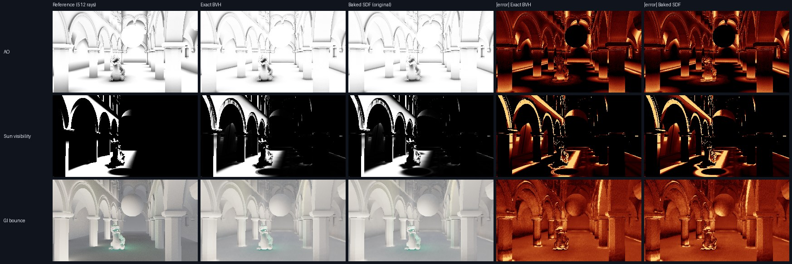
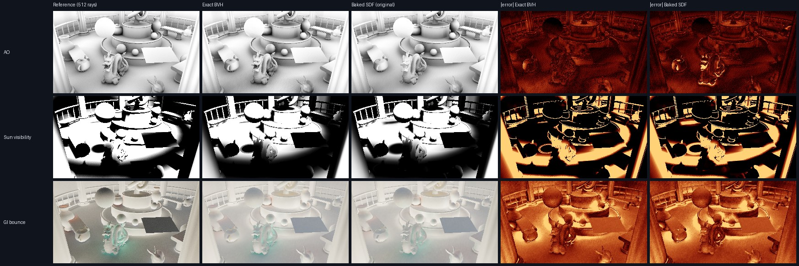

# Moving objects: Exact BVH vs Baked SDF (original method)

`webgpu.html` traces moving objects in two ways (the **Mover rays** switch):

- **Exact BVH** (default): every ray is transformed into each mover's local space and intersected with its
  triangles through a per-mesh BVH (`src/webgpu-movers.js`).
- **Baked SDF (original)**: each mesh is baked into a 64³ FP16 local distance field and `min()`'d into the
  scene distance at its current transform, so rays sphere-trace it like static geometry.

Both rasterize the same meshes; only what AO, GI, shadow and reflection rays see differs. Quality is scored
by `benchmark/bench_movers.cjs` + `eval_movers.py` against `tools/trace_gi` (512 cosine rays + 64 solar-disk
shadow rays per pixel) traced on the exact world-space triangles of the posed scene, on 57,600 pixels. Movers
are frozen and each mode converges for 32–40 frames at 1280×720, `high` preset.

## Scenes

| Scene | Static | Movers |
|---|---|---|
| **Sponza + dragon** | Dabrovic Sponza, 66,444 tris, 12 cm SDF (see note below) | 202k-tri Stanford dragon walking the courtyard (3 m), gold mirror sphere (analytic), chrome bunny, teapot: 222k moving tris |
| **Stress test** | curved Atrium, 13,704 tris, 11.6 cm SDF | 8 movers: dragon 202k, 2 bunnies, teapot, torus knot, 1.2 cm thin ring, open canopy plate, gold mirror sphere: 270k moving tris |

Sponza note: the numbers below were measured with the first Sponza build, an *unsigned* SDF (the model has
3.5% open edges) and the textured stone floor. Unsigned distances never reach zero between voxel centres, so
SDF rays (mirror reflections, far GI, the static part of shadows) could pass through surfaces; this affected
both mover methods equally. `build_sponza.py` now bakes a signed field with `bake_sdf --sign vote` (majority
of the +x/+y/+z winding numbers, robust to the holes) and gives the floor the gold mirror material.

## Quality

Mean absolute error against the reference on **mover-affected pixels** (where the reference with movers
differs from the reference without them); lower is better.

| Metric | Sponza: Exact BVH | Sponza: Baked SDF | Atrium: Exact BVH | Atrium: Baked SDF | Ignoring movers (Sponza / Atrium) |
|---|---:|---:|---:|---:|---:|
| AO | **0.035** | 0.056 | **0.035** | 0.035 | 0.182 / 0.134 |
| AO, 95th percentile | **0.124** | 0.200 | **0.087** | 0.094 | |
| Sun visibility | **0.073** | 0.099 | **0.087** | 0.148 | 0.780 / 0.568 |
| Sun visibility, 95th percentile | **0.403** | 0.644 | **0.386** | 0.706 | |

**Mover effect only** (Sponza; error of (GPU with movers − GPU without) against (reference with − reference
without) on 8×8-pixel block means, which removes the renderer's static-scene bias and per-pixel noise):

| Effect captured | Exact BVH | Baked SDF |
|---|---:|---:|
| AO | **94%** | 83% |
| Sun shadows | **81%** | 67% |
| GI bounce | 8% | 1% |

- **Shadows** are where the methods differ most: exact hits keep the dragon's spout, claws and thin parts
  (27–41% lower error, ~40% lower 95th percentile). The baked SDF's 1–2 cm voxels and penumbra estimate blur
  and fatten them (sun-visibility bias −0.07 to −0.14).
- **AO**: the baked SDF under-occludes next to large movers (Sponza bias +0.054 vs +0.019) and loses contact
  occlusion where the dragon touches the floor; on the smaller Atrium movers the two are on par.
- **GI bounce**: neither method reproduces the movers' small effect on bounce light (≈0.02–0.03 linear). The
  two differ by < 0.002 and the residual is systematic (it survives block averaging), so it comes from the
  renderer's GI model, not the mover tracing: the radiance volume used for off-screen hits does not contain
  movers, and the renderer adds a sky term for escaping rays that the reference does not.





Columns: reference, Exact BVH, Baked SDF, |error| Exact BVH, |error| Baked SDF (0 → black, ≥ 0.25 → bright).
Rows: AO, sun visibility, GI bounce. Static-scene errors (e.g. shadow edges of the arches, the renderer's
overall GI brightness) are identical in both modes.

## Cost

Measured headless on **SwiftShader (CPU-emulated WebGPU)**: absolute times are meaningless and relative
costs on a real GPU may differ (texture sampling is cheap in hardware, BVH traversal divergence is not).
Use the **Run benchmark** button in `webgpu.html` for real GPU timestamps.

| Median frame time, movers animating | Sponza | Atrium stress test |
|---|---:|---:|
| No movers, cache off (baseline: same per-pixel work) | 6.50 s | 7.08 s |
| Exact BVH | 7.76 s (**+19%**) | 9.06 s (**+28%**) |
| Baked SDF (original) | 9.72 s (+50%) | 12.77 s (+80%) |

Exact BVH is cheaper here because each ray visits each nearby mover once, while the baked-SDF method evaluates
every nearby mover's distance field at every march step of every ray (AO, GI, shadows, reflections).

| Preparation | Exact BVH | Baked SDF |
|---|---|---|
| Per mesh | CPU binned-SAH build: 0.46 s for the 202k dragon, 2.4 s for the 871k full-resolution dragon (Node) | GPU bake of a 64³ slab (in-browser baker) |
| Memory | ~54 B/triangle (10.5 MiB for the 202k dragon) | 512 KiB per mesh (8 MiB atlas, 16 meshes) |
| Limits | rigid motion, 8 instances per frame | rigid motion, 16 baked meshes, closed meshes for a correct sign, detail below ~1 voxel lost |

## Reproduce

```bash
npm i --no-save bunny@1.0.1 stanford-dragon@1.1.1 jp.keijiro.dabrovic-sponza@1.0.0
node benchmark/build-stress-meshes.cjs && python3 benchmark/build_sponza.py
node benchmark/bench_movers.cjs --scene sponza   # or --scene stress; add --swiftshader without a GPU
```

Outputs (raw buffers, references, `report.md`, images) go to `benchmark/mover-bench/<scene>/`.

Models: Stanford Bunny and Dragon, Stanford 3D Scanning Repository (Stanford Computer Graphics Laboratory).
Sponza by Marko Dabrovic, with UVs and fixes by Kenzie Lamar (Vicarious Visions); free for non-commercial use
with attribution. The models are generated locally and not redistributed in this repository.
